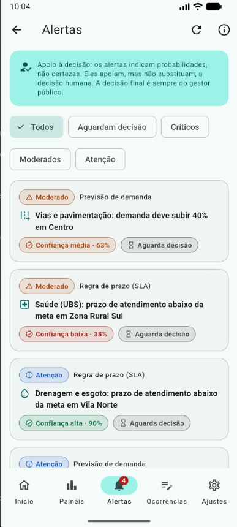
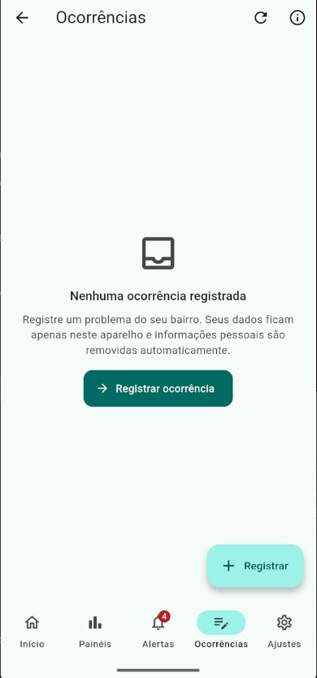
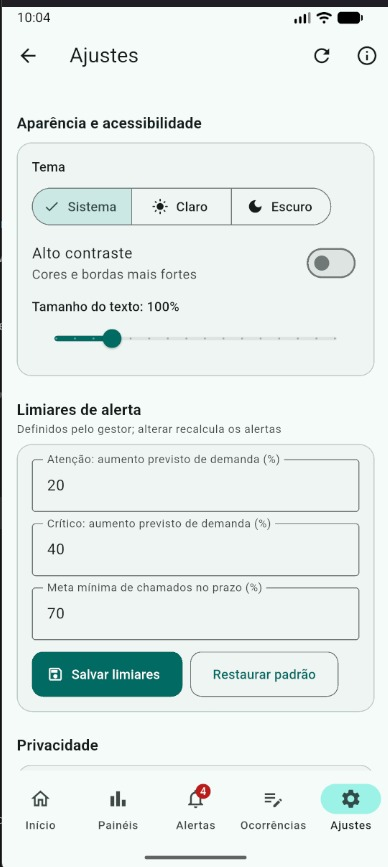

# Territory Predictive Insights

> Painel mobile em Flutter que antecipa a **demanda por serviços públicos** em um território, mostrando previsões e alertas sempre com justificativa, nível de confiança e limitações, e deixando a decisão final com o gestor.

<!-- Banner/logo opcional: coloque em assets/banner.png e descomente -->
<!--  -->

## 1. Problema e público

**Problema.** Prefeituras costumam reagir à demanda por serviços (iluminação, coleta de resíduos, vias, saúde, drenagem) só depois que os chamados se acumulam e os prazos de atendimento estouram. Isso piora a qualidade de vida, principalmente em regiões com menos recursos.

**O que o app antecipa.** Aumentos previstos de chamados nos próximos 7 dias, por região e tipo de serviço, e queda no cumprimento de prazos de atendimento (SLA). O clima (chuva) entra como um dos fatores.

**Para quem.**
- **Gestores públicos:** acompanham indicadores, previsões e alertas e registram a decisão (aceitar para análise ou descartar).
- **Cidadãos:** registram ocorrências de forma anônima e entendem como os dados são usados.

**Impacto social esperado.** Mais chamados resolvidos no prazo, menor diferença de atendimento entre regiões (equidade) e ação preventiva antes do pico de demanda. O app exibe esses indicadores na tela *Visão geral*.

## 2. Integrantes

| Nome completo | RM |
|---|---|
| _[Felipe Rodrigues Ribeiro dos Santos]_ | _[RM:565274]_ |
| _[Manoela Oliveira Bello]_ | _[RM:563952]_ |

## 3. Demonstração visual

| | |
|---|---|
| <br>**Consentimento explícito** antes de entrar | <br>**Visão geral:** KPIs, benefício social e alertas prioritários |
| <br>**Painel 1 · Demanda:** histórico e previsão de 7 dias | <br>**Painel 2 · Territórios:** demanda por mil habitantes e prazo por região |
| <br>**Painel 3 · Clima × demanda:** chuva e chamados | <br>**Alertas** com filtros e aviso de decisão humana |
| <br>**Detalhe do alerta:** evidências e confiança | <br>**Limitações, vieses e decisão do gestor** |
| <br>**Detalhe do indicador** por serviço e região | <br>**Ocorrências:** estado de lista vazia |
| <br>**Formulário** com validação e mensagens de erro | <br>**Ajustes:** acessibilidade, limiares e privacidade |
| <br>**Metodologia, métricas e limitações** | <br>**Estado de erro** com nova tentativa |
| <br>**Tema escuro** | <br>**Alto contraste e fonte ampliada** |

## 4. Funcionalidades

- [x] 10 telas com rotas nomeadas e passagem de parâmetros (visão geral → indicador → alerta)
- [x] 3 painéis distintos: demanda, territórios e clima × demanda, com gráficos, cards, histórico e tendência
- [x] Alertas gerados por previsão (demanda) e por regra (prazo de atendimento)
- [x] Cada alerta com justificativa (evidências), nível de confiança, limitações e sugestão para análise
- [x] Aviso visível de que os alertas apoiam, mas não substituem, a decisão humana
- [x] Registro da decisão do gestor (aceitar/descartar, com justificativa), persistido localmente
- [x] Estado global (Provider) compartilhado entre várias telas, com estados de carregamento, erro e lista vazia
- [x] Dados de API real (Open-Meteo) com cache local; app útil sem conexão
- [x] Persistência local de ocorrências, limiares, preferências, decisões e cache do clima
- [x] Formulários com validação: registro de ocorrência e configuração de limiares
- [x] Indicadores de benefício social (prazo, equidade entre regiões, população com alerta revisado)
- [x] Acessibilidade: contraste, fonte ajustável, alto contraste, rótulos para leitores de tela
- [x] Privacidade: consentimento, anonimização de textos e apagar dados
- [x] Diferenciais: dados reais (clima), modo escuro, alto contraste, animações com propósito, testes automatizados

## 5. Dados e alertas

**Fonte dos dados**

| Dado | Origem | Tipo |
|---|---|---|
| Chuva e temperatura (60 dias + 7 de previsão) | API pública [Open-Meteo](https://open-meteo.com), sem chave | Real |
| Chamados por região e serviço, prazos (SLA) | Gerador determinístico no app, simula uma central 156 | Sintético |
| Ocorrências do cidadão | Digitadas no app, salvas só no aparelho | Autorizado (com consentimento) |

O território **Aurora do Vale** é fictício (5 regiões, 206 mil habitantes). A referência climática é a região metropolitana de São Paulo.

**Como os alertas são gerados**

1. **Previsão de demanda** (por região × serviço): tendência linear + sazonalidade por dia da semana + efeito da chuva, ajustados nas últimas 5 semanas. O alerta surge se a previsão dos próximos 7 dias superar a média semanal das últimas 4 semanas acima do limiar de atenção (padrão 20%; crítico a partir de 40%).
2. **Regra de prazo (SLA)**: alerta se menos de 70% dos chamados dos últimos 14 dias foram resolvidos no prazo (meta configurável).

**Métricas**

- **WAPE** em backtest: o modelo "prevê" os últimos 7 dias já conhecidos e mede-se o erro: soma|erro| / soma(real).
- **Confiança** = 1 − WAPE, limitada a 95%. Para alertas de prazo, depende do tamanho da amostra (máx. 90%).
- Correlação de Pearson entre chuva e chamados no painel de clima.

**Limitações**

- Modelo simples: não captura feriados, obras, campanhas ou eventos extremos.
- Volume pequeno de chamados deixa a previsão instável (há volume mínimo para gerar alertas).
- Os dados de demanda são sintéticos e não representam um município real.
- Correlação entre chuva e chamados não prova causalidade.

**Possíveis vieses**

- **Subnotificação:** regiões com menos acesso ao canal de atendimento registram menos chamados do que a necessidade real. Por isso o app compara regiões por mil habitantes e mostra o indicador de equidade.
- Prazo mede velocidade, não qualidade do atendimento.

**Quando as previsões não são confiáveis**

- Confiança abaixo de 50% ou histórico menor que 3 semanas.
- Previsão de chuva muito incerta ou mudança brusca de comportamento (nova obra, campanha).
- Regiões ou serviços com poucas ocorrências por semana.

**Decisão humana.** Nenhuma ação é automática. Cada alerta exibe o aviso de apoio à decisão, e o gestor aceita ou descarta com justificativa opcional.

## 6. Privacidade e inclusão

**Privacidade**

- Tela de **consentimento explícito** na primeira abertura.
- Não coletamos nome, CPF, telefone, e-mail nem localização exata; só a **região** (bairro/zona).
- Textos livres passam por **anonimização** (remove CPF, telefone e e-mail) antes de salvar.
- Dados ficam **apenas no aparelho**. Em *Ajustes* é possível **apagar tudo e revogar o consentimento**.
- Nenhuma chave de API é necessária e nenhuma credencial está no repositório.

**Acessibilidade**

- Contraste adequado (cores semânticas com ícone e texto, nunca só cor) e tema de **alto contraste**.
- **Tamanho do texto ajustável** (85% a 160%) e layouts que se adaptam a fontes grandes.
- **Leitores de tela:** rótulos semânticos em cartões, gráficos (resumo textual), botões e campos.
- Áreas de toque de ao menos 48 px e tema claro/escuro.
- Layout responsivo (celular e tablet, largura máxima centralizada).

## 7. Tecnologias e decisões técnicas

| Escolha | Justificativa |
|---|---|
| **Flutter + Material 3** | Um código para Android e iOS, com componentes acessíveis. |
| **Provider** (`ChangeNotifier`) | Simples e suficiente: estado global (território, ajustes, ocorrências) separado do estado local (filtros, formulários). |
| **shared_preferences** | Persistência leve para preferências, limiares, ocorrências, decisões e cache. Volume pequeno, sem necessidade de banco. |
| **http** + Open-Meteo | API pública sem chave e sem cadastro; permite dados reais sem expor credenciais. |
| **Gráficos com `CustomPainter`** | Sem dependência externa, controle total (previsão tracejada, barras de chuva) e resumo textual para leitores de tela. |
| **Previsão própria e explicável** | Regressão linear + sazonalidade + chuva: transparente e auditável, adequada a decisões públicas. Evita caixa-preta. |
| **Rotas nomeadas (`onGenerateRoute`)** | Navegação central com argumentos tipados (`IndicatorArgs`, `AlertArgs`). |

**Arquitetura (camadas)**

```
lib/
├─ core/        tema, rotas e utilitários (formatadores, validadores, anonimizador)
├─ domain/      regras puras sem Flutter: entidades, previsão, motor de alertas, impacto social
├─ data/        fontes e persistência: gerador sintético, clima (API+cache), repositório, LocalStore
├─ state/       controllers (ChangeNotifier): Settings, Territory, Occurrences
└─ ui/
   ├─ screens/  telas
   └─ widgets/  componentes reutilizáveis (cartões, KPIs, badges, gráficos, estados)
test/           testes de unidade e de widget
```

## 8. Como executar

Pré-requisitos: Flutter 3.24+ (Dart 3.5+), Android Studio/Xcode ou um dispositivo.

```bash
git clone <URL-DO-REPOSITORIO>
cd territory_predictive_insights
flutter pub get
flutter run
```

- **Variáveis de ambiente:** nenhuma. A API Open-Meteo não exige chave.
- **Testes:** `flutter test`
- **Análise estática:** `flutter analyze`
- **APK de release:** `flutter build apk --release` (arquivo em `build/app/outputs/flutter-apk/app-release.apk`; também disponível em *Releases* do repositório).

> Sem internet, o app usa o último clima salvo; sem cache, usa clima simulado e avisa na tela. Em *Ajustes* há um botão para simular falha de rede e ver o estado de erro.

## 9. Vídeo

🎥 _[Cole aqui o link do vídeo de demonstração (até 3 minutos)]_

## 10. Licença

Projeto acadêmico, FIAP, Global Solution 2026.2.
